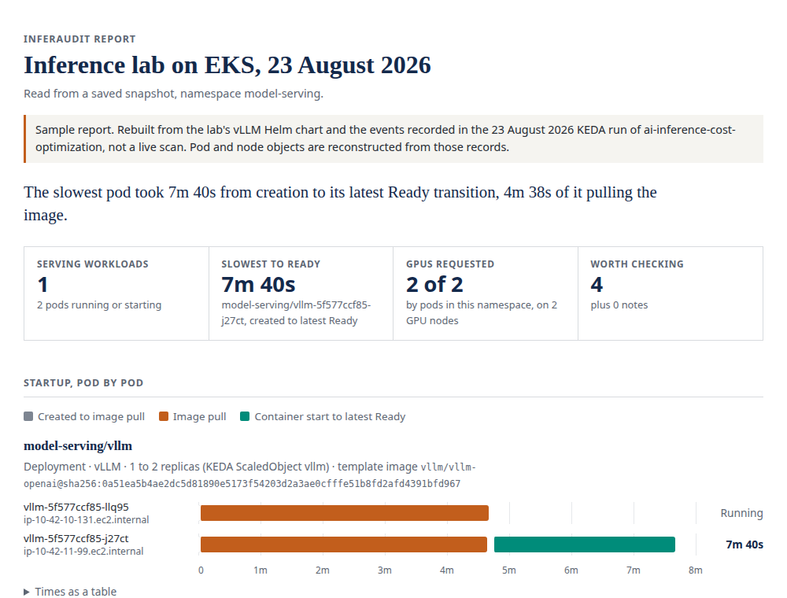

# inferaudit

A read-only review of how AI models are served on a Kubernetes cluster. It finds vLLM, TGI,
Triton, SGLang, Ollama, NIM and KServe pods, plus anything that asks for an `nvidia.com/gpu` or
`amd.com/gpu`, shows the startup intervals visible in pod status and kubelet events, flags
settings worth a second look, and writes it all up as a single HTML page you can send to someone.



That's the sample report, built from a [KEDA autoscaling run](https://github.com/vjsairam/ai-inference-cost-optimization/tree/main/results/published/20260823T141339Z-8d3374c4-t5-autoscale)
in my inference lab. A second vLLM replica took 7 minutes 40 seconds to become Ready on a
GPU node that was already up, and most of that was pulling a 9.1 GB image.

## What it checks

| Area | What it looks at |
|---|---|
| Startup | Image pull time as the kubelet reports it, container start to the latest Ready transition, and whether vLLM's model cache is kept between pods |
| Reliability | Single replicas, missing PodDisruptionBudgets, missing readiness probes, and liveness or startup probe settings to compare with startup logs |
| Reproducibility and access | Images without a fixed version, vLLM serving a Hugging Face model with no `--revision`, vLLM with no API key setting, model Services exposed through a LoadBalancer or NodePort |
| GPUs | GPUs on each node against GPUs requested by pods |

Each finding says what was seen, why it matters and what to do next. Things the cluster's
objects can't prove, such as whether a load balancer is reachable from the internet, are
worded as something to confirm. When a read fails or a setting lives somewhere it doesn't
parse, the check is skipped and the report says so, rather than guessing.

## Install

With Go 1.26 or later:

```sh
go install github.com/vjsairam/inferaudit@latest
```

To use it as `kubectl inferaudit`, put a copy on your `PATH` named `kubectl-inferaudit`.

## Use

```sh
inferaudit                              # current context, all namespaces
inferaudit --context prod -n serving    # one namespace
inferaudit --select app=my-model        # also include workloads it doesn't recognise
inferaudit --json report.json           # JSON as well as the HTML report
```

The report goes to `inferaudit-report.html` unless you pass `--html`.

To review a cluster you can't reach from where you want to read the report, save a snapshot
and run against it later:

```sh
inferaudit --save snapshot/             # on a machine with cluster access
inferaudit --from snapshot/             # anywhere
```

The snapshot is plain `kubectl get -o json` output, one file per resource type, so you can
read exactly what was collected. It can include secrets written literally into environment
variables, arguments or annotations, so review it before sharing. Reports name workloads,
nodes, images and models. Both are written readable only by you.

To see the sample report yourself, run `inferaudit --from testdata/lab-2026-08-23` from a
clone of this repo.

## What it needs

It runs `kubectl config current-context` once and then `kubectl get`, so it needs `list` on
pods, replicasets, deployments, statefulsets, services, poddisruptionbudgets,
horizontalpodautoscalers, events, nodes and, if KEDA is installed, scaledobjects. kubectl
itself may run whatever authentication plugin your kubeconfig names. Anything it can't read
is listed in the report, and checks that depend on it are skipped.

## What it can't see

- GPU utilisation. Requests show what pods reserved, not how busy the GPUs are. Spare GPUs
  are only reported when every namespace was read.
- Network reachability. Exposure findings come from Service settings; nothing is probed.
- Older starts. Kubernetes keeps events for an hour by default, so pull times for pods that
  started earlier are usually gone. Run it soon after a rollout or scale-up.
- First starts. Pod status keeps only the latest Ready transition, and a restarted pod's first
  start is gone, so only its image pull is shown.
- Settings outside the pod spec. vLLM flags inside a shell script or a `--config` file aren't
  parsed, and only one serving container per pod is checked.

## Status

Early. The checks come from problems I've hit running vLLM on EKS with KEDA, and it has been
run against the lab data above and a local kind cluster. Issues and pull requests are welcome,
especially reports from clusters that look different from mine.

Built by [Sai Ram](https://vjsairam.com). MIT licensed.
